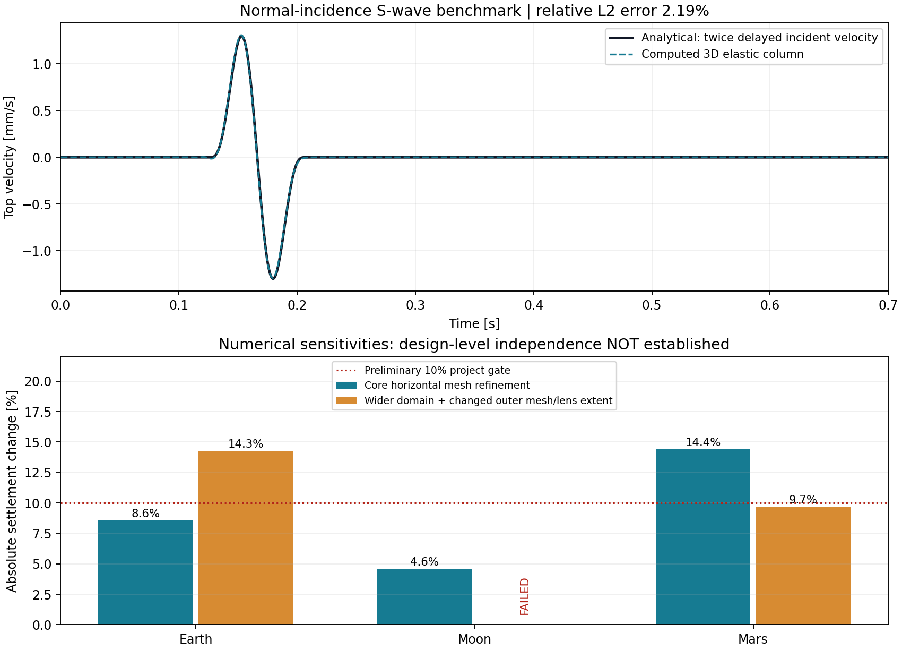

# 지구·달·화성 혼합 3D 지반·SSI 업데이트 보고서

작성일: 2026-11-02. 대상 실행환경: `/Users/sydney/anaconda3/envs/cap/bin/python`, OpenSees 엔진 **3.4.0**.

## 현재 도달한 단계

**혼합 3차원 지반 생성 → 기초·예제 구조물 연결 → 조립체 자중 → 추가 정적 하중 → 결과 출력**까지 실제 실행되는 기준 구현을 만들었다. 지구·달·화성 전환, 제공된 세 DEM, 3자유도 지반과 6자유도 구조물 연결, 동적 경계 및 입사파 API를 포함한다.

현재는 **구조물 코드 연결을 시작할 수 있는 검증된 작은 예제와 API** 단계다. 모든 크기·하중에서 쓸 수 있는 비선형 지반 모델이나 설계용 확정 재료값까지 완료한 것은 아니다. 특히 달의 큰 조립 모델, 메시·영역 독립성, 큰 미끄러짐은 남았다. 이 문제를 숨기기 위해 강도·점착력·허용오차를 임의로 변경하지 않았다.

실제 돔/하이퍼볼로이드 구조물 코드·기초 치수·접촉면·하중이 아직 없으므로, 이번 기초와 기둥의 크기는 **연결 시험용 가정**이다. 재료의 수치 구성식 검증과 현장 지반의 실험 보정도 구분했다.

## 파일 위치와 실행

| 용도 | 파일/폴더 |
|---|---|
| 실행 진입점 | [ground_modeling.py](/Users/sydney/Desktop/capstone/Capstone_structure/ground/ground_modeling/ground_modeling.py) |
| 새 실제 구현 | [ground_hybrid](/Users/sydney/Desktop/capstone/Capstone_structure/ground/ground_modeling/ground_hybrid) |
| 사용법·API·문헌 | [README_HYBRID_KO.md](/Users/sydney/Desktop/capstone/Capstone_structure/ground/ground_modeling/README_HYBRID_KO.md) |
| 원본 백업 | [ground_modeling_before_hybrid_20261102.py](../archive/ground_modeling_20261116/backups/ground_modeling_before_hybrid_20261102.py) |
| 기존 보정 재료, 변경하지 않음 | [material_release_20261101](/Users/sydney/Desktop/capstone/Capstone_structure/material/material_release_20261101) |
| 확장 지반 재료 카탈로그 | [materials.json](/Users/sydney/Desktop/capstone/Capstone_structure/ground/ground_modeling/ground_hybrid/configs/materials.json) |
| 기본 예제 결과 | [hybrid_results](/Users/sydney/Desktop/capstone/Capstone_structure/ground/ground_modeling/hybrid_results) |
| 수치 검증 결과 | [hybrid_verification](../archive/ground_modeling_20261116/hybrid_verification) |

```sh
cd /Users/sydney/Desktop/capstone/Capstone_structure/ground/ground_modeling
/Users/sydney/anaconda3/envs/cap/bin/python ground_modeling.py --body Earth --demo-frame
/Users/sydney/anaconda3/envs/cap/bin/python ground_modeling.py --body Moon --demo-frame
/Users/sydney/anaconda3/envs/cap/bin/python ground_modeling.py --body Mars --demo-frame
```

단위는 **m, N, s, kg, Pa**다. 기본 영역은 **6×6×12m**, 기초는 **2×2×0.4m**이며, 자중 평형 후 **추가 10kPa**를 재하한다. `--demo-frame`은 3m 강재 기둥 4개와 총 4,000kg 집중질량을 포함한다. 기본 비선형 지반 요소 수는 지구 128개, 달·화성 각 144개다.

원래 시험한 12×12×12m, 약 2천 요소 설정은 `configs/*_large_candidate.json`에 남겼다. 작은 기본 모델은 **연결 검증용**이며 영역 크기 독립성의 대체물이 아니다. 렌즈 일부가 작은 영역 경계에서 잘린다는 점도 설정에 기록했다.

큰 설정은 다음처럼 별도 출력 폴더와 시간 제한을 사용한다.

```sh
/Users/sydney/anaconda3/envs/cap/bin/python -m ground_hybrid.bounded_run --timeout-s 180 --config ground_hybrid/configs/Moon_large_candidate.json --demo-frame --output hybrid_results/moon_trial
```

시간 제한은 별도 자식 프로세스를 종료하며, 해당 실행은 종료 코드 124로 실패 처리한다. 출력 파일이 남아 있어도 성공한 결과라는 뜻은 아니다. CLI 결과의 `RUN_STATUS.json`에서 `status=success`, `complete=true`를 확인한다. 강제 종료 때는 미완료 상태가 남을 수 있다. 성공한 재실행은 과거 `FAILED.json`을 제거한다.

## 재료 선정·튜닝에서 바꾼 점

단일 균질 재료 대신 **서로 다른 물성을 가진 층·렌즈·기반암 영역**으로 단순화했다. 실제 구성성분의 입도별 배합이나 개별 입자 접촉을 계산하는 모델은 아니다. 내부 경계는 절점을 공유하는 완전 부착 연속체다. 지역별 층 두께와 렌즈 위치를 문헌에서 실측한 것처럼 취급하지 않았다.

“가장 많이 사용된 값”이라는 빈도 순위를 입증할 자료는 없으므로, **실험·탐사 연구와 공식 모델 제안값 중 출처가 확인되는 기준값**을 채택했다.

| 대상 | 채택 내용 | 근거와 남은 불확실성 |
|---|---|---|
| 지구 건조 모래 | Dr30/50/75의 층·느슨한 렌즈 + 탄성 기반암. 기본은 DP 정적 단순화, PDMY02 선택 가능 | [OpenSees 공식 제안 계수](https://opensees.berkeley.edu/wiki/index.php/PressureDependMultiYield02_Material). G/K의 기준압력 80→101kPa 환산 및 공극비 기반 건조밀도 정리. 포항 실제 지층 재현은 아님 |
| 달 레골리스 | 기존 JSC-1A 밀도군 1.7/1.8/1.9의 보정값 + 느슨한 렌즈 + 탄성 기반암 | 기존 삼축 요약자료 보정 재사용. φ≈42.97/45.57/49.48°, E≈15.10/20.45/17.25MPa, 기본 c=0. 시험 구속압 15–60kPa 이하의 천부 달 지반 외삽과 작은 변형 동적 강성은 미확정 |
| 화성 매트릭스 | JEZ-1 φ40.6°, c3.1kPa, ρ1840kg/m³, E30MPa | [JEZ-1 직접전단 연구](https://www.mdpi.com/2076-3417/11/15/7052). E는 기존 가정이며 새 측정값으로 보정한 것이 아님 |
| 화성 표층·렌즈 | InSight crust 대용재: φ30°, c5.8kPa, ρ1200kg/m³, E11.48MPa, ν0.28 | [Spohn 외, 2022](https://pmc.ncbi.nlm.nih.gov/articles/PMC9734249/). 강도·밀도 조건과 천부 평균 파동 기반 강성의 조합. 특정 얇은 crust의 정적 E를 직접 측정한 값은 아님 |
| 기반암 | 탄성 현무암질 아날로그: E40GPa, ν0.3, ρ2900kg/m³ | [Musiol 외, 2016, Table 1 crust](https://gfzpublic.gfz.de/rest/items/item_1802896_4/component/file_1802898/content). 세 천체의 실제 암반·절리를 측정한 값은 아님 |
| 달 현장 점착력 후보 | 별도 `moon_field_proxy_17/18/19`, c=0.52/0.90/3.0kPa | [NASA 가이드 Table 18](https://ntrs.nasa.gov/api/citations/20240011783/downloads/Lunar_Regolith_Simulant_Users_Guide_Rev_A_28OCT.pdf)의 현장 c와 JSC 물성 조합. 원 연구의 깊이 구간도 현재 모델과 다름. 큰 조립 모델에서 추가 하중 완료를 확인하지 못해 **기본값으로 채택하지 않음** |

이번 추가 튜닝은 **기존 보정 재사용, 문헌 상수 확장, 단위·구성식 변환 및 응답 검증**이다. 새 시험자료를 확보해 모든 재료를 재최적화한 작업은 아니다. DP의 일정 강성·완전소성 모델은 압력 의존 강성이나 반복 다짐을 재현하지 않는다. 카탈로그의 peak/residual 재료가 자동으로 변형률에 따라 전환되는 연화 모델도 아니다.

지구 PDMY02는 작은 탄성 자리잡기 하중 후 비선형 중력 재하를 사용한다. 선택형 예제도 이번에 기초·기둥·10kPa까지 완료했지만 단계 축소와 반복 재시도가 필요했다. 기본 DP와 구성식·응답이 다르며 서로 같은 보정 모델이라고 볼 수 없다. 두 모델 중 무엇이 실제 지반에 더 적합한지는 실제 자료와 목표 하중 경로로 판단해야 한다.

## 구현상 보완한 부분

| 항목 | 적용한 내용 |
|---|---|
| 구조물 보존 | `build_ground()` 내부 `ops.wipe()` 제거. 전체 초기화는 CLI 또는 전체 모델 소유자만 수행. 기존 구조물 노드 보존·태그 충돌 검사 |
| 자중·질량 | 요소 밀도는 관성 질량에 사용. 체적 적분한 일관 절점 자중을 별도 부여. 중복 질량·중복 중력 방지, 힘과 모멘트 적분 확인 |
| 혼합 지반 | 3D `bbarBrick`, 층 경계 포함 수직 메시, 위치 기반 렌즈, 물성별 실제 체적분율 기록 |
| 기초·SSI | 3DOF 지반과 6DOF 탄성 RC 판 연결. 면적 분담 접촉·마찰·들뜸 구성요소, 판 회전을 임의 고정하지 않음 |
| 연결 API | 기초 노드 직접 재사용 또는 일치 좌표의 6DOF 노드 연결. 임의 최근접 노드 연결 금지. 병진·회전 전달 검증 |
| 초기 상태 | 지반·기초·구조물을 먼저 조립한 뒤 자중 재하. 추가 침하는 조립체 자중 평형 이후 기준. 이미 변형한 지반에 무응력 기초를 설치하는 별도 시공 단계는 미구현 |
| 비선형 해석 | 실제 하중계수·평형·유한값 확인, 단계 축소·알고리즘 재시도. 실패 시 허용오차나 물성을 조용히 변경하지 않음 |
| 동적 경계 | 평형 반력을 외력으로 보존한 뒤 구속 해제, 면적 기반 ρVsA/ρVpA 점성 경계. 상향 입사 속도 입력의 2ρcAv 힘 API |
| DEM | 제공 HGT/PDS4/PDS3 원본 직접 memmap 읽기. rasterio 불필요. 달 고위도 경도의 cos(latitude) 보정, 결측·타일 경계 검사, 원본 해상도와 FE 메시 구분 |
| 출력·추적 | JSON, 연결 절점, VTK, 독립 HTML, 소스·설정 해시, 실행 완료 상태. 설정 JSON의 강성 배율이 CLI 기본값으로 덮어써지던 문제 수정 |

기초 RC는 무균열 초기 탄성 모델이며 판 기준면과 접촉면의 편심을 0으로 단순화했다. 마찰계수는 지구·달 0.35 가정, 화성은 JEZ-1/매끈한 강판 계수를 전용한 가정이다. 실제 콘크리트 기초 접촉 실측값으로 취급하면 안 된다. `Plain` + identity `equalDOF`로 검증했으며 다른 제약 처리 방식·연쇄 MP는 별도 확인이 필요하다.

DEM의 기본 위치 원본 간격은 지구 약25×31m, 달 약3.9×29.6m, 화성 약429×463m다. 보간해 작은 요소를 만든다고 지형 실측 정밀도가 좋아지는 것은 아니다. `--prepare-pad`는 초기 평탄 지형 작성이며 굴착·성토의 응력 이력을 계산하지 않는다.

## 실제 검증 결과

| 검증 | 결과 | 범위 |
|---|---|---|
| 핵심 검증 | **14/14 묶음 통과** | 기하·자중 적분, API 보호, 6DOF 연결, 재료, 천체별 탄성 층상기둥·비선형 조립체·경계 평형, S파 |
| 재료 단위요소 | **36/36 통과** | DP 11재료 × 구속압 1/15/60kPa + PDMY02 3재료 반복전단. 문헌/실험의 독립 현장 검증과는 다름 |
| 기본 CLI | **3/3 통과** | 평면 지형, 비선형 지반·기초·기둥·자중·10kPa, HTML/VTK/연결 포트 출력 |
| 원본 DEM CLI | **3/3 통과** | 세 천체 원본 DEM·평탄 패드·기초·기둥·자중·10kPa |
| CLI 보호 | **3/3 통과** | JSON 강성 배율 보존/이전 실패 표시 제거, 잘못된 지형 실패 표시, 자식 프로세스 시간 종료 |
| 민감도 | **21조건 중 20조건 해석 완료** | 달의 넓은 영역은 실패/시간 제한. 수치 민감도 비교 12개 중 9개만 임시 기준 만족 |

핵심 검증의 탄성 층상기둥 침하는 해석식과 상대오차 약10⁻¹⁶ 수준으로 일치했고, 체적 자중 모멘트 적분 상대오차는 약2.49×10⁻¹⁵였다. 기초 중복 연결 노드의 6자유도 차이는 0이고 회전 전달도 확인했다. 세 비선형 조립 검증의 전체 힘 평형 상대오차는 10⁻¹⁵ 수준 이하, 접촉 MP 오차는 0이었다. 흡수 경계 전환 후 무입력 25스텝의 드리프트는 10⁻¹⁵m 수준 이하였다. 이는 수치적인 평형·연결 검사이며 모델의 현장 정확도를 의미하지 않는다.

균질 탄성 10m 기둥의 수직 입사 S파는 Vs≈79.189m/s, 전파시간≈0.12628s이고, 자유표면 응답과 해석해의 상대 L2 오차는 **2.19%**, 늦은 반사 구간의 상대 진폭은 약2.70×10⁻⁶이었다. Δz=0.125m, Δt=0.00025s 조건이다. 임의 입사각·실제 층상 지진·자유장 경계까지 검증한 결과는 아니다.



### 기본 예제의 추가 침하

동일한 2×2m 기초에 추가 10kPa를 재하한 **면적 가중 평균 추가 침하**다. 조립체 자중 침하는 제외된다. 천체별 물성·층상 조건이 다르므로 중력 차이만의 영향 비교가 아니다.

| 시나리오 | 평면 지형 [mm] | 원본 DEM + 초기 패드 [mm] |
|---|---:|---:|
| 지구 | 0.071189 | 0.071284 |
| 달 | 0.816958 | 0.814921 |
| 화성 | 0.482447 | 0.481624 |

이번 기본 CLI 실행 시간은 각 약3–6초였고, 핵심 14묶음 검증은 약40초였다. 모델 크기·하중·수렴 경로가 달라지면 이 시간을 기대할 수 없다. 위 침하값을 실제 구조물의 설계 침하로 사용하지 않는다.

검증 원본: [핵심 요약](../archive/ground_modeling_20261116/hybrid_verification/summary.json), [재료 36조건](../archive/ground_modeling_20261116/hybrid_verification/material_summary.json), [CLI·DEM 6조건](../archive/ground_modeling_20261116/hybrid_verification/smoke.json), [민감도](../archive/ground_modeling_20261116/hybrid_verification/sensitivity.json).

## 통과하지 못한 부분과 판단

1. **달의 큰 비선형 조립 모델.** 12×12m·2,016개 지반 요소에 기초/기둥을 연결한 조건은 수렴 문제가 남았다. 같은 큰 지반의 **기초 없는 자중 해석은 통과**했다. 따라서 큰 지반 메시 자체가 항상 실패하는 것은 아니며, 기초·접촉·국부 응력 경로를 포함한 원인 분리가 필요하다. 이를 접촉 오류나 실제 지지력 파괴라고 단정할 근거는 아직 없다.
2. **문헌 점착력 후보도 해결책으로 확정하지 못함.** 큰 달 모델의 자중은 완료했지만 추가 10kPa 경로가 완료되지 않았다. 임시 기초 구속 후보 역시 채택하지 않았다. 실패 로그는 `hybrid_results/diagnostics/`에 보존했다.
3. **메시·영역 독립성 미확보.** 기준 대비 지구 영역 확대 침하 변화 절댓값 14.30%, 화성 수평 메시 세분화 14.43%로 임시 10% 기준을 넘었다. 달 영역 확대는 비교값 자체를 확보하지 못했다. 접촉 페널티 0.5/2배 변화는 세 천체에서 각각 임시 5% 이내였다. 이 5/10%는 프로젝트의 예비 기준이며 설계기준 조항이 아니다.
4. **영역 시험은 순수 경계거리 시험이 아님.** 현재 영역 확대는 외곽 메시와 포함되는 렌즈 체적도 바꾼다. 실제 형상 연결 후에는 렌즈 전체를 포함한 최소 영역에서 출발해 중심 메시·재료 분포를 고정하고 외곽만 늘리는 별도 시험이 필요하다.
5. **큰 미끄러짐·반전 미검증.** `displacement_path()`는 실험용이다. 조립 모델의 큰 수평 변위 경로는 실패했고, 현재 자료로 미끄러짐 용량을 제시하지 않는다. 접촉 구성요소 단품 검증이 전체 지반-기초 조립체의 검증을 대신하지 않는다.
6. **정적 E와 동적 Gmax의 차이.** 특히 달의 삼축 할선/접선 강성과 화성의 가정 강성을 사용한 파동 결과는 수치 참조다. 실제 지진 해석에는 구속압별 강성, 감쇠·반복 이력 자료 또는 명시적인 범위 가정이 필요하다.

지하수·액상화·빙질 지반, 온도·진공에 따른 물성 변화, 암석 절리, 유한 미끄러짐 접촉, 다중 지점 강제 부등침하, 실제 돔 내압·풍·운석 충돌의 검증은 포함하지 않았다. 부등침하 **응답 출력**은 구현됐지만 임의 다중 지점의 강제 침하 입력까지 구현한 것은 아니다.

## 다음 작업 순서

1. **구조물 코드가 오면 연결부터 진행:** 기초 접점 좌표·절점 자유도·단위·부재 질량·자중을 확인하고 `raft['nodes']`에 직접 연결한다. 실제 구조물과 기초를 먼저 만들고 `initialize_gravity()`를 호출한다. 현재는 구조물 크기를 추측해 전체 돔을 임의로 만들지 않았다.
2. **동일 실제 형상에서 탄성 기준해 확보:** 기초 편심·RC 유효 강성·접촉 면적을 맞추고, 탄성 지반에서 전체 힘·모멘트·변위 전달을 먼저 확인한다. 이를 비선형 단계의 비교 기준으로 보관한다.
3. **달의 문제 분리:** 동일 큰 메시에서 탄성 지반+비선형 접촉, 비선형 지반+제어된 단순 하중 등으로 하중 단계별 응력·접촉 상태를 비교한다. 실패 위치와 경로를 확인한 뒤 구성식/접촉 방식/초기화 개선을 결정한다. 단지 계산이 끝나도록 c나 φ를 올리지 않는다.
4. **메시와 경계거리 분리 검증:** 실제 기초 폭을 기준으로 영역을 정하고, 렌즈 전체를 포함한 상태에서 중심 메시와 재료 형상을 유지한다. 외곽 거리, 수평 세분화, 수직 세분화, 접촉 페널티를 각각 바꿔 침하·반력·회전 변화를 확인한다.
5. **실제 하중 순서 적용:** 자중 → 내압/상부 구조 하중 → 실제 동적 입력 순으로 검증한다. 구조물 크기와 강성이 정해진 뒤 동적 해상도·시간 간격·경계·감쇠를 다시 정한다. 운석 충돌은 별도 모델로 둔다.

재료 선정표와 연결용 코드의 초안 단계는 지금 넘어갈 수 있다. **재료 튜닝을 모두 끝낸 설계 모델로 확정하는 단계는 아직 남아 있다.** 현재 가장 효율적인 다음 행동은 재료 상수를 계속 임의 조정하는 일이 아니라, 실제 구조물 연결 및 위 세 가지 핵심 미완료 항목의 검증이다.

## 재현 명령

```sh
cd /Users/sydney/Desktop/capstone/Capstone_structure/ground/ground_modeling
/Users/sydney/anaconda3/envs/cap/bin/python ground_modeling.py --verify
/Users/sydney/anaconda3/envs/cap/bin/python -m ground_hybrid.smoke
/Users/sydney/anaconda3/envs/cap/bin/python -m ground_hybrid.sensitivity --timeout-s 60
```

민감도 명령은 미통과 조건이 있으면 종료 코드 1을 반환한다. 현재 그 실패는 보고된 결과이며 무시하거나 전체 통과로 바꾸지 않았다. 기본 3D 그림은 각 `hybrid_results/천체/ground_cutaway.html`, 구조물 연결 정보는 `structure_ports.json`에서 확인할 수 있다.

## 후속 업데이트: 지형·재료·동적 변형 HTML 뷰어

`ground_modeling.py`의 일반 실행이 성공하면 이제 `ground_viewer.html`을 생성하고 기본 브라우저에 열도록 했다. `--no-open`은 자동 열기만, `--no-html`은 HTML과 화면용 동적 기록을 생략한다. 기존 `ground_cutaway.html` 링크에는 동일한 독립 HTML 사본을 유지했다.

전체 지반/반쪽 단면/지표면 전환, 재료 숨기기와 체적비·물성 확인, 요소 경계, 표고·변위 크기·수직 변위 색상, 변형 기준과 확대 배율 선택을 추가했다. 동적 해석에는 재생·일시정지·시간 슬라이더·속도 조절·저장 프레임 최대 변위 그래프가 생긴다. 기초 판과 예제 기둥도 함께 변형된다. 정적 실행의 재생 버튼은 비활성화된다.

애니메이션에는 해석에서 수렴한 절점 변위를 사용한다. 프레임 저장은 계산 시간 간격과 독립이며 초기·최종 상태를 포함한다. 기본 최대151프레임이고 `--html-frames`로 변경한다. 화면 좌표는 초기 좌표에 선택한 기준 대비 변위×배율을 더한 값이며, **실제 변위 수치는 mm로 별도 표시**한다. 임의 사인파를 지형 좌표에 덧붙인 애니메이션이 아니다. 다만 현재 `pulse` 입력 자체는 합성100N 펄스이고 현장 지진 기록은 아니다.

추가 검증 결과:

- 기존 핵심14묶음, 정적/DEM CLI6조건 재실행 통과.
- 동적 CLI3조건 통과: 지구·달은 각각0.1초/101프레임, 화성은 DEM·기초·기둥 포함0.3초/151프레임.
- 화면 기록 활성화/비활성화의 실제 계산 변위가 정확히 같음을 확인. 초기·최종·중간 저장 프레임이 관측점과 일치함을 확인.
- JSON 삽입·정적 모드·호환 파일·브라우저 열기 호출(모의 호출) 검증 통과.
- JavaScript 구문과 모의 DOM/Plotly 환경의 재생·단면·재료 숨기기·변위 색상·표시 좌표 검사 통과. 실제 Plotly 스키마 검사 및 외부 자산 태그가 없는 독립 HTML 구조 확인.
- **실제 브라우저 화면의 렌더링은 직접 검증하지 못했다.** 내부 브라우저의 보안 정책이 로컬 `file:` URL을 차단했으며 다른 경로로 우회하지 않았다. 위 검증은 브라우저 GPU 렌더링·시각 배치 확인을 대신하지 않는다.

예제: [화성 DEM 동적 뷰어](/Users/sydney/Desktop/capstone/Capstone_structure/ground/ground_modeling/hybrid_results/Mars_dynamic_viewer/ground_viewer.html), [달 동적 뷰어](/Users/sydney/Desktop/capstone/Capstone_structure/ground/ground_modeling/hybrid_results/Moon_dynamic_viewer/ground_viewer.html), [지구 동적 뷰어](/Users/sydney/Desktop/capstone/Capstone_structure/ground/ground_modeling/hybrid_results/Earth_dynamic_viewer/ground_viewer.html).

새 구현은 `ground_hybrid/viewer.py`, 화면은 `ground_hybrid/viewer.html`, 검증 명령은 `python -m ground_hybrid.viewer_verification`이다. 상세 실행 명령은 [사용 안내](/Users/sydney/Desktop/capstone/Capstone_structure/ground/ground_modeling/README_HYBRID_KO.md)의 HTML 절을 참조한다. 이 시각화 추가가 앞서 기록한 달의 큰 비선형 조립 모델·메시 독립성·큰 미끄러짐의 미완료 상태를 바꾸지는 않는다.
